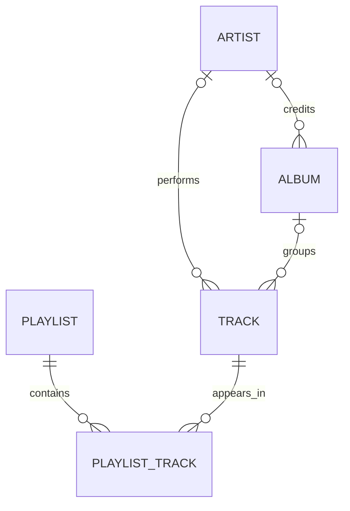

# Phase 5.1 — Room Schema

**Milestone:** 5 — Library & data  
**Priority:** Foundational  
**Depends on:** 4.1  
**Status:** Implemented and verified on Android

## Objective

Create Room entities/DAOs for tracks, albums, artists, and basic playlists schema — without full MediaStore scanning yet.

## Why it matters

Library UX needs a local index. Schema mistakes are expensive to migrate; start small and intentional.

## Architecture

```text
android-app (or future data layer)
  Room DB
    Artist / Album / Track / Playlist / PlaylistTrack
```

Playback still uses engine URIs; DB does not decode audio.

## Schema v1



Rows use generated local IDs. Display names and titles can repeat. Tracks can have an unknown artist or album, and album artist can differ from track artist. Optional unique artist and album source keys can hold provider identifiers scoped to their source and volume when available.

A track's unique `uri` is its complete, canonical source identifier. A MediaStore entry uses its volume-specific content URI. The optional `path` records a known filesystem path when available and is never used to deduplicate rows. Scan code can look up a URI and update the existing row ID, preserving playlist references.

Browse indexes cover names, titles, album track ordering, and artist relationships. Playlist entries have their own IDs and a unique position within each playlist. A track can appear multiple times in one playlist. Deleting a playlist or track removes its entries. Deleting an artist or album clears optional relationships. Position gaps after deletion preserve ordering.

## Migration policy

The generated schema is exported under `android-app/schemas` and kept in source control. The database builder requires a versioned migration for an existing version change. An early disposable development database can be deleted explicitly. Application upgrades must preserve rows and playlist membership through tested migrations. [Room migration guide](https://developer.android.com/training/data-storage/room/migrating-db-versions)

## Learning objectives

- Room entities, DAOs, migrations mindset.
- Normalization basics for music libraries.
- Why path/URI identity matters.

## Scope

**Included**
- Entities + DAOs + Database class.
- Simple insert/query unit tests (in-memory DB).
- Indices for common browse queries.

**Excluded**
- Scanner (5.2).
- Artwork files (5.4).
- Full-text search engine beyond basic LIKE/Query (can enhance later).

**Must not implement yet**
- Writing EQ DSP coefficients as blobs without need (presets later).

## Implementation steps

1. Draft ERD briefly in this phase’s notes.
2. Implement Room schema v1.
3. In-memory instrumented/unit tests.
4. Document migration policy (destructive OK early; versioned later).

## Expected project structure

```text
android-app/.../data/db/
  HowlDatabase.kt
  entities/*.kt
  dao/*.kt
```

## Testing strategy

- Insert track → query by album/artist.
- Playlist membership round-trip.

## Acceptance criteria

- [x] Schema supports library browse essentials.
- [x] Tests pass on the in-memory Room database.
- [x] The database can be opened independently of the UI and scanning.
- [x] URI and path field strategy documented.

## Review checklist

- [ ] Understand relationships and indices.
- [ ] Know what is deferred to migrations.

## Potential pitfalls

- Over-modeling tagging systems early.
- Using display titles as unique keys.
- Blocking main thread with Room (use correct dispatchers later).

## Completion report

| Field | Notes |
|-------|-------|
| What was built | Room v1 schema for artists, albums, tracks, playlists, and ordered playlist membership. |
| Files created/modified | Database, entities and DAOs, Gradle dependencies, exported v1 schema, and Android instrumentation. |
| Tests executed | Android debug build and unit test, plus Android instrumentation against an in-memory database on the API 36 emulator. |
| Results | Verified album and artist browse, URI uniqueness, identity-preserving updates, playlist position ordering and uniqueness, repeated tracks, and foreign-key actions. |
| Known limitations | The app will populate and surface the library in later phases. Playlist reordering and preference storage are planned for 5.3. |
| Decisions made | Generated IDs for references, unique source URIs for tracks, optional provider keys for artist and album identity, and versioned migrations for upgrades. |
| Next phase | 5.2 — Media scanning & permissions |

**Approval required before Phase 5.2.**
